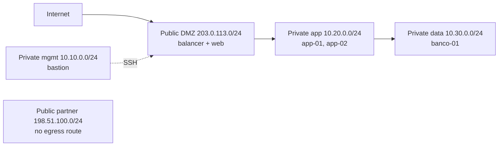

# vpc-3-tier-segura

**English** · [Português (Brasil)](README.md)

[](#) [](#) [](#) [](#.github/workflows/ci.yml) [](LICENSE)

## What it is

A **3-tier VPC (Virtual Private Cloud) simulator** with a **stateful firewall**, a management **bastion** and a **path tracer**. `vpcsim` loads a fictitious architecture (defined in YAML), applies firewall rules in declared order, and answers, for each packet of a test scenario, whether it reaches its destination — with the path and the deciding rule. It is a cloud-network/security lab, entirely fictitious, with no real cloud access.

> Note: the previous README described a **credit-card fraud detection** project (copied from another repository) and cited `scikit-learn`/`pandas`, which do not exist here. Corrected.

## Status

An educational networking/security lab, working and tested (105 tests).

## Features

- **3-tier architecture** (DMZ → application → data) plus management and partner layers, defined in `dados/arquitetura.yaml` with CIDRs and visibility.
- **Stateful firewall with deterministic order**: 17 rules evaluated top to bottom; the first match decides.
- **Path tracer**: given a scenario (packet source→destination/port), shows whether traffic passes and why.
- **Least-privilege principle** and **cloud security model** documented in `docs/`.
- **CLI**: `tracar`, `cenarios`, `regras` and `arq` commands.

## Architecture

Fictitious lab architecture (`LAB-VPC-FICT`):



Each packet goes through the rule engine (`regras.py` + `firewall.py`), which applies the 17 rules in file order; an explicit `deny` closes the policy (the engine already denies when nothing matches).

## Stack

- Python ≥ 3.10
- PyYAML ≥ 6.0 (only runtime dependency)
- pytest + pytest-cov (dev)
- CI: GitHub Actions on `windows-latest` (Python 3.11) with a 70% coverage floor plus encoding/acceptance checks

## Repository layout

```
vpc-3-tier-segura/
├── src/vpcsim/
│   ├── cli.py        # tracar/cenarios/regras/arq commands
│   ├── firewall.py   # stateful firewall engine
│   ├── regras.py     # applies rules in order
│   ├── rede.py       # nodes, subnets, routes
│   ├── cenarios.py   # runs the test scenarios
│   └── tracador.py   # traces the path of each packet
├── dados/
│   ├── arquitetura.yaml      # layers, CIDRs, nodes
│   ├── regras.yaml           # 17 rules (order = policy)
│   └── cenarios-teste.yaml   # traffic scenarios
├── tests/             # 105 tests
├── docs/              # security model, least privilege
├── exemplos/          # generated traffic traces
└── LICENSE            # MIT
```

## Prerequisites and installation

Python ≥ 3.10. For development/tests:

```bash
python -m pip install -e ".[dev]"
```

## How to run

```bash
# Trace the path of each packet in the scenarios
python -m vpcsim tracar dados/cenarios-teste.yaml

# List the scenarios and the verdict of each one
python -m vpcsim cenarios dados/cenarios-teste.yaml

# Show the rule table in evaluation order
python -m vpcsim regras

# Show the layers, nodes and routes of the architecture
python -m vpcsim arq
```

## Tests and quality

Real run (verified by the agent):

```bash
python -m pytest tests/
# 105 passed
```

- CI: `ci.yml` (windows-latest, Python 3.11) installs, checks encoding, imports the package, runs pytest with coverage (`fail-under=70`) and runs the acceptance verification.

## Technical decisions and trade-offs

- **Rule order = policy**: the YAML file is evaluated top to bottom; moving a line changes what the VPC accepts.
- **Stateful firewall**: the return of a legitimate connection is handled by the inbound rules; with no return route the packet simply disappears.
- **100% fictitious data**: no real cloud is accessed (RFC 5737 documentation CIDRs).
- **Minimum dependencies**: only PyYAML to keep the lab light and reproducible.

## Known limitations and roadmap

- Conceptual simulation: it does not emulate latency, loss or the real behavior of a cloud provider.
- IPv4 scope only; no IPv6 or L7 firewall.
- Test scenarios are fixed; adding new ones requires editing the YAML.

## Development process

An individual project by Kelvin Oliveira, built with orchestrated AI agents and reviewed by the author. The VPC modeling, the firewall engine and the review are the author's.

## License and author

MIT — Copyright (c) 2026 Kelvin Rebelo de Oliveira.

**Author**: [Kelvin Oliveira](https://github.com/KelvinOliveiraCode) · [Portfolio](https://kelvinoliveiracode.github.io/portfolio/)
