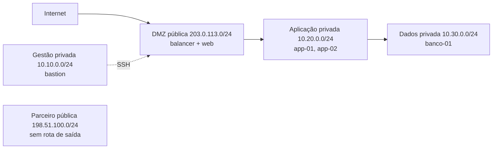

# vpc-3-tier-segura

[English](README.en.md) · **Português (Brasil)**

[](#) [](#) [](#) [](#.github/workflows/ci.yml) [](LICENSE)

## O que é

Simulador de **VPC (Virtual Private Cloud) em 3 camadas** com **firewall stateful**, **bastion** de gestão e **tracer de caminho**. O `vpcsim` carrega uma arquitetura fictícia (definida em YAML), aplica regras de firewall na ordem declarada e responde, para cada pacote de um cenário de teste, se ele chega ao destino — com o caminho e a regra que decidiu. É um laboratório de redes/segurança em nuvem, tudo fictício, sem acessar nuvem real.

> Nota: o README anterior descrevia um projeto de **detecção de fraude em cartão** (copiado de outro repositório) e citava `scikit-learn`/`pandas`, que não existem aqui. Corrigido.

## Status

Laboratório educacional de redes/segurança, funcional e testado (105 testes).

## Funcionalidades

- **Arquitetura em 3 camadas** (DMZ → aplicação → dados) mais gerência e parceiro, definida em `dados/arquitetura.yaml` com CIDRs e visibilidade.
- **Firewall stateful com ordem determinística**: 17 regras avaliadas de cima para baixo; a primeira que casa decide.
- **Tracer de caminho**: dado um cenário (pacote origem→destino/porta), mostra se o tráfego passa e por quê.
- **Princípio do menor privilégio** e **modelo de segurança em nuvem** documentados em `docs/`.
- **CLI**: comandos `tracar`, `cenarios`, `regras` e `arq`.

## Arquitetura

Arquitetura fictícia do laboratório (`LAB-VPC-FICT`):



Cada pacote atravessa o motor de regras (`regras.py` + `firewall.py`), que aplica as 17 regras na ordem do arquivo; um `negar` explícito fecha a política (o motor já nega quando nada casa).

## Stack

- Python ≥ 3.10
- PyYAML ≥ 6.0 (única dependência de runtime)
- pytest + pytest-cov (dev)
- CI: GitHub Actions em `windows-latest` (Python 3.11), com cobertura mínima 70% e verificações de encoding/aceite

## Estrutura do repositório

```
vpc-3-tier-segura/
├── src/vpcsim/
│   ├── cli.py        # comandos tracar/cenarios/regras/arq
│   ├── firewall.py   # motor de firewall stateful
│   ├── regras.py     # aplica as regras na ordem
│   ├── rede.py       # nós, sub-redes, rotas
│   ├── cenarios.py   # executa os cenários de teste
│   └── tracador.py   # rastreia o caminho de cada pacote
├── dados/
│   ├── arquitetura.yaml      # camadas, CIDRs, nós
│   ├── regras.yaml           # 17 regras (ordem = política)
│   └── cenarios-teste.yaml   # cenários de tráfego
├── tests/             # 105 testes
├── docs/              # modelo de segurança, menor privilégio
├── exemplos/          # traços de tráfego gerados
└── LICENSE            # MIT
```

## Pré-requisitos e instalação

Python ≥ 3.10. Para desenvolvimento/testes:

```bash
python -m pip install -e ".[dev]"
```

## Como executar

```bash
# Rastreia o caminho de cada pacote dos cenários
python -m vpcsim tracar dados/cenarios-teste.yaml

# Lista os cenários e o veredito de cada um
python -m vpcsim cenarios dados/cenarios-teste.yaml

# Mostra a tabela de regras na ordem de avaliação
python -m vpcsim regras

# Mostra as camadas, nós e rotas da arquitetura
python -m vpcsim arq
```

## Testes e qualidade

Execução real (verificada pelo agente):

```bash
python -m pytest tests/
# 105 passed
```

- CI: `ci.yml` (windows-latest, Python 3.11) instala, confere encoding, importa o pacote, roda pytest com cobertura (`fail-under=70`) e roda a verificação de aceite.

## Decisões técnicas e trade-offs

- **Ordem das regras = política**: o arquivo YAML é avaliado de cima para baixo; mover uma linha muda o que a VPC aceita.
- **Firewall stateful**: o retorno de uma conexão legítima é tratado pelas regras de ida; sem rota de volta o pacote desaparece.
- **Dados 100% fictícios**: nenhuma nuvem real é acessada (CIDRs de documentação RFC 5737).
- **Mínimo de dependências**: só PyYAML para manter o laboratório leve e reprodutível.

## Limitações conhecidas e roadmap

- Simulação conceitual: não emula latência, perda ou o comportamento real de um provedor de nuvem.
- Escopo em IPv4; sem suporte a IPv6 ou firewall L7.
- Os cenários de teste são fixos; adicionar novos exige editar o YAML.

## Processo de desenvolvimento

Projeto individual de Kelvin Oliveira, construído com agentes de IA orquestrados e revisado pelo autor. A modelagem da VPC, o motor de firewall e a revisão são do autor.

## Licença e autor

MIT — Copyright (c) 2026 Kelvin Rebelo de Oliveira.

**Autor**: [Kelvin Oliveira](https://github.com/KelvinOliveiraCode) · [Portfólio](https://kelvinoliveiracode.github.io/portfolio/)
